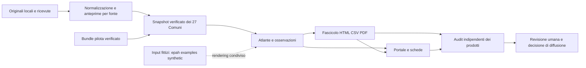

# Architettura dello strumento EPAH Diagnosis

Destinatari: chi valuta la repository, sviluppa il software o verifica un
prodotto territoriale. Il software stabile è v0.4.0 (solo sorgenti); il percorso v0.4
produce bozze tecniche. Non cambia fonti, metodi o stati canonici.

## Il percorso da comprendere per primo

Lo strumento separa la preparazione delle fonti dalla costruzione dei prodotti.
Un input disponibile non è automaticamente validato. Un prodotto coerente
non è automaticamente approvato per diffusione.



Le assenze sono dati del contratto: `not_acquired` è diverso da zero.
Le 16 posizioni dell'atlante comprendono nove serie pilota e sette candidati;
432 righe non provano che tutte contengano un'osservazione.

## Confini e responsabilità implementati

| Livello | Punto di ingresso o moduli | Responsabilità | Cosa non decide |
| --- | --- | --- | --- |
| Interfaccia | `workflow_cli.py`, comando `epah outputs` | Esporre `plan` e `run`; delegare | Nessuna formula o approvazione |
| Applicazione v0.4 | `review_workflow_v0_4.py` | Pianificare una catena consentita, riusare gli stessi input, fermarsi al primo errore, registrare log/esiti | Non acquisisce fonti, non esegue piani JSON forniti dall'esterno |
| Dimostrazione sintetica | `synthetic_example_v0_4.py`, `epah examples synthetic` | Generare input fittizi e usare rendering/audit comuni, con ricevuta e destinazione nuova | Non esegue ingestione di fonti e non produce un pilota verificato |
| Adattatori delle fonti | `scripts/prepare_*`, `scripts/normalize_*`, estrattori e moduli di dominio | Interpretare una fonte secondo il suo contratto, mantenendo originali e QA | Non promuovono candidati sulla base della sola aritmetica |
| Revisione fonte UTCI v0.5 | `utci_export_review_v0_5.py`, `utci_review_portal_v0_5.py`, `epah methodology utci-portal` | Ricalcolare l'audit dell'originale e rendere lo snapshot in un pacchetto HTML con copia e hash | Nessuna acquisizione, deduzione di unità, aggregazione comunale o approvazione |
| Snapshot e metadati | `atlas_observations_v0_4.py`, `candidate_observations_v0_4.py`, `editorial_catalog_v0_4.py`, `evidence_ledger_v0_4.py` | ID, valori, periodi, universi, conteggi, provenienza e assenze comuni ai formati | Non definiscono un indice composito |
| Presentazione | `visual_atlas_v0_3.py`, `visual_atlas_v0_4.py`, `review_pack_v0_4.py`, `municipality_sheets_v0_4.py`, `output_hub_v0_4.py`, moduli grafici/cartografici | Rendere lo stesso snapshot in HTML, CSV, PDF e immagini | Non ricalcolano gli indicatori dalla fonte |
| Pubblicazione locale dei file | `directory_publication.py` | Esporre una directory già completa senza sostituire evidenze precedenti | Non autorizza la pubblicazione istituzionale |
| Verifica dei prodotti | `output_quality_v0_4.py`, `output_bundle_quality_v0_4.py`, controllo browser | Confrontare manifest e contenuti, compresi PDF/CSV | Non attestano rappresentatività o validazione scientifica |

I file della tabella sono in `src/epah_diagnosis/`, salvo i comandi indicati
esplicitamente sotto `scripts/`. Gli script storici restano compatibili.

Il builder territoriale conserva tutti i controlli sulle fonti prima di chiamare
il rendering condiviso dell'atlante. La dimostrazione fornisce uno snapshot
fittizio esplicito allo stesso rendering: non sostituisce funzioni globali e
non accetta input territoriali o opzioni per ignorarne i gate. La CLI delega
al servizio; non genera valori né contiene formule.

## Una sola catena operativa per gli output

`epah outputs plan` non crea file e non esegue builder. Controlla presenza e
separazione dei percorsi, poi mostra comandi e candidati mancanti. I controlli
semantici restano nei builder e negli audit esistenti.

`epah outputs run` ricostruisce il proprio piano; non accetta comandi arbitrari.
Per impostazione predefinita richiede tutti i candidati. Una revisione parziale
richiede `--allow-incomplete` ed è registrata come tale, anche se gli audit
sono positivi. H03/H04 devono essere passati insieme; H47/H50/H46 sono
riutilizzati identici nel fascicolo per conservare denominatori e ricevute.

```text
nuova-esecuzione/
  run.json        stato della catena, passi, disponibilità, hash degli esiti
  logs/           un log per passo, conservato anche in caso di errore
  atlas/          snapshot, catalogo, evidenze, grafici e HTML
  review/         osservazioni CSV e fascicolo HTML/PDF dello stesso snapshot
  hub/            portale offline autosufficiente, schede e sintesi
  qa/             audit del fascicolo e del portale, esterni ai prodotti
```

Il portale da consultare o trasferire è `hub/index.html`, mantenendo la sua
cartella intera. La directory di esecuzione può includere percorsi privati nei
log: non pubblicarla in Git come se fosse un prodotto approvato.

## Ciclo di vita dei risultati

Ogni renderer prepara una directory temporanea sullo stesso filesystem della
destinazione. Dopo i controlli usa `publish_directory`: Windows esegue una
rinomina che rifiuta destinazioni esistenti; POSIX riserva prima la destinazione
vuota e sostituisce solo quella prenotazione. Un'operazione fallita non cancella
ricorsivamente directory di output e non ripulisce archivi precedenti.

Il servizio applicativo conserva l'esecuzione fallita e i suoi log. Non elimina
prodotti già riusciti per simulare un rollback complessivo. Per riprovare si
sceglie una directory nuova. `run.json` è la sola ricevuta aggiornata durante
l'esecuzione: non riscrive i manifest degli input o dei prodotti.

Gli stati `technical_review_ready` e `technical_review_incomplete` descrivono
solo il pacchetto tecnico. `scientific_approval` e `publication_allowed` restano
falsi; revisione visiva, scientifica e autorizzazione sono decisioni separate.

## Organizzazione della repository

| Percorso | Contenuto | Regola |
| --- | --- | --- |
| `src/epah_diagnosis/` | Libreria, servizi applicativi, rendering e audit | Nuova logica riutilizzabile qui, senza effetti al momento dell'import |
| `scripts/` | Comandi storici, acquisizioni e builder versionati | Compatibilità e delega; evitare una seconda implementazione delle formule |
| `tests/` | Fixture sintetiche, integrità, errori e isolamento | Nessun originale privato; test di capacità del filesystem dove necessari |
| `docs/` | Contratti, architettura, uso, metodo e storia | Separare guide attuali e resoconti datati |
| `config/`, dati canonici | Definizioni e stati revisionati | Nessuna variazione implicita da un builder di output |
| `data/downloads/`, `outputs/`, `artifacts/` | Originali ed elaborazioni locali ignorati da Git | Conservare le evidenze, non distribuirle come parte del sorgente |

## Debito tecnico dichiarato e prossimi incrementi

Questa è una struttura operativa incrementale, non una riscrittura completa:

1. I builder atlante v0.3/v0.4 risiedono in libreria. I vecchi comandi sono
   wrapper della rispettiva funzione `main`; i test usano direttamente i moduli.
   La v0.4 importa la v0.3 normalmente, senza caricamenti dinamici degli script.
2. L'orchestrazione completa usa ancora comandi consentiti sotto `scripts/`
   e configurazioni del checkout. Questa modifica non rende l'intero workflow
   un'applicazione distribuibile senza i sorgenti. Una migrazione successiva
   dovrà conservare le interfacce e verificare lo stesso snapshot.
3. Gli adattatori delle fonti hanno contratti diversi. Armonizzarli richiede
   ricevute e casi di errore per fonte; non un parser universale che indovini
   unità, categorie, denominatori o anni.
4. Il gate dedicato `scripts/check_v0_4_release.py` e il workflow manuale
   legano la release software a commit e ambito degli asset; non certificano
   approvazione scientifica. Il gate storico v0.3 conserva il proprio contratto.

Per lavorare sul codice: [guida sviluppatore](v0_4_developer_guide.md).
Per la consegna parziale e il file locale degli input:
[chiusura tecnica v0.4](v0_4_technical_closeout.md). Il modello di revisione
in `review/` è un template immutabile legato allo snapshot; le note del revisore
si compilano in una copia esterna e non promuovono stati canonici.
La [v0.5 metodologica](v0_5_methodology.md) mantiene separati proposte, benchmark
e dati comunali: il suo controllo valida metadati, non calcoli o approvazioni.
Per provare i prodotti senza originali: [esempio sintetico](v0_4_synthetic_example.md).
Per ciò che richiede evidenze o decisioni esterne:
[dossier delle decisioni aperte](v0_4_scientific_decisions.md).
